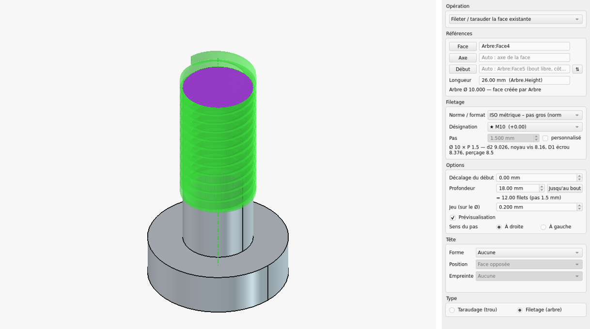
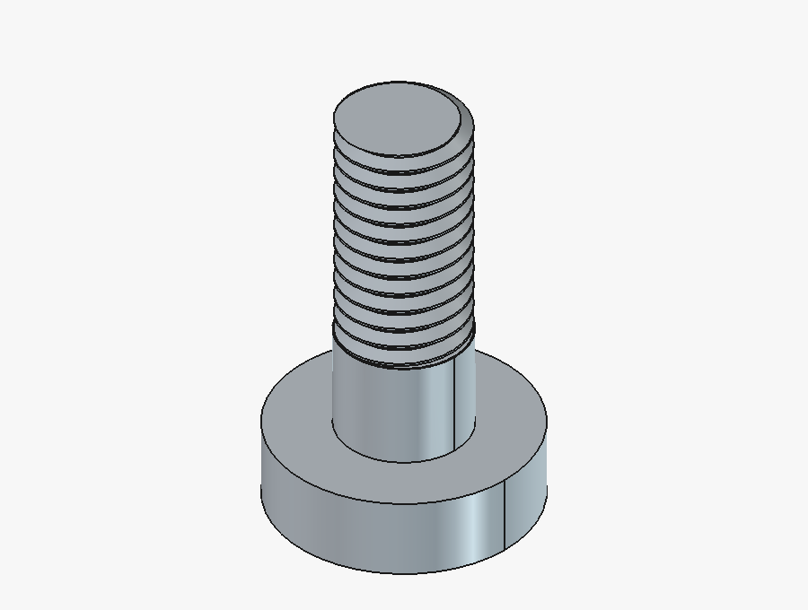
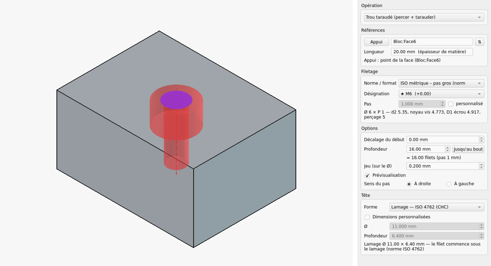
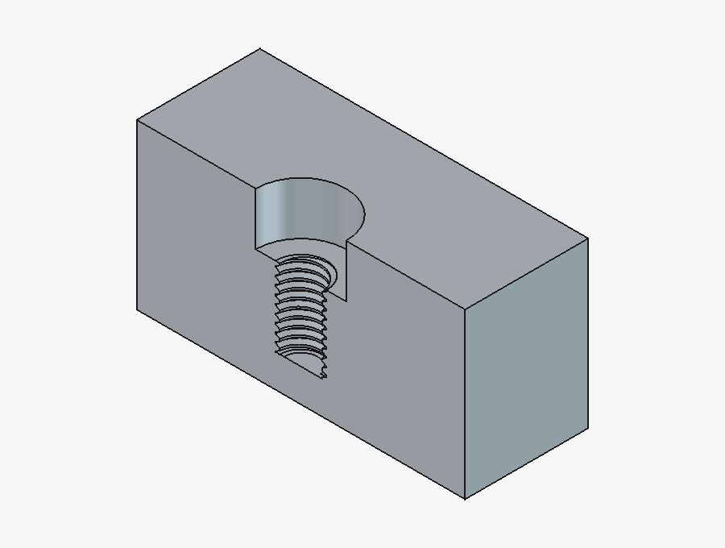
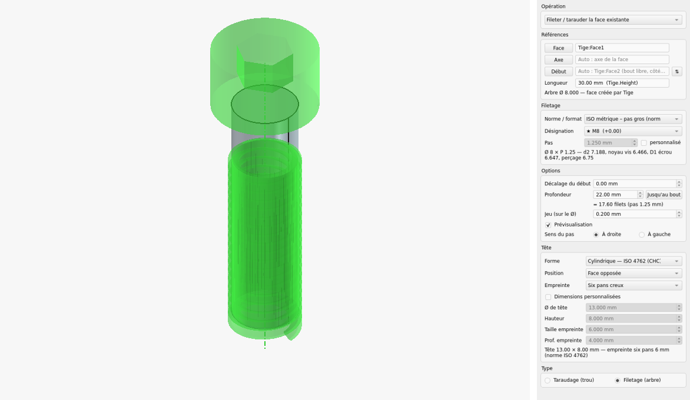
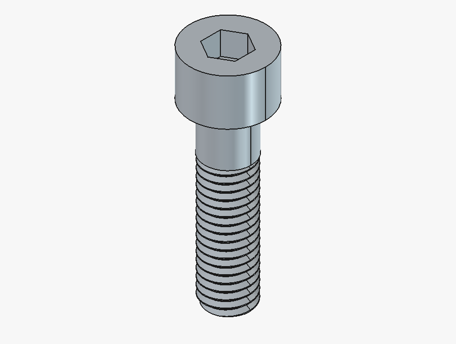

# ThreadTool — filetage / taraudage pour FreeCAD PartDesign

Ajoute un bouton **Filetage / taraudage** dans l'atelier Part Design, à côté de **Perçage**.
Il suffit de cliquer sur une face cylindrique : l'outil détecte s'il s'agit d'un trou (taraudage) ou d'un arbre (filetage), propose la norme la plus proche (ISO M, UNC/UNF/UNEF, BSP G, BSW/BSF, NPT, BSPT, Tr ou personnalisé), ajuste le diamètre puis creuse l'hélice.

Testé avec **FreeCAD 1.1.1** (AppImage Linux) et **FreeCAD 1.1.4** (Windows 11).

L'interface est en **français** quand FreeCAD est en français, en **anglais** pour les autres langues, ou dans toute autre langue dont le fichier de traduction existe (voir [Ajouter une langue](#ajouter-une-langue)).

> **English** — Adds a **Thread / tap** command to Part Design, next to **Hole**. Click a cylindrical face: the tool detects a hole (internal thread) or a shaft (external thread), proposes the closest standard (ISO M, UNC/UNF/UNEF, BSP G, BSW/BSF, NPT, BSPT, Tr or custom), adjusts the diameter and cuts the helix. The interface follows FreeCAD's language: French, English, or any language that has a translation file.

## Aperçu

**Filetage** d'un arbre Ø10 en M10 : il suffit de cliquer la face cylindrique, la norme et la longueur sont proposées.

| Panneau et aperçu | Résultat |
|---|---|
|  |  |

**Trou taraudé M6 avec lamage ISO 4762** : clic sur une face plane, choix de la tête ; le filet commence sous le lamage (vue en coupe).

| Panneau et aperçu | Résultat (coupe) |
|---|---|
|  |  |

**Vis CHC M8** : tige filetée, tête cylindrique ISO 4762 et empreinte six pans creux, dans la même fonction.

| Panneau et aperçu | Résultat |
|---|---|
|  |  |

Les images sont refaites par `freecad docs/screenshots.py` (FreeCAD en interface graphique).

---

## Installation (Windows, Linux, macOS)

Trois méthodes au choix. Dans tous les cas, **redémarre FreeCAD** ensuite et ouvre l'atelier **Part Design** : l'icône (cylindre + croix + 3/4 de cercle) est juste à gauche de **Perçage**, et la commande est aussi dans le menu **Part Design**.

### A. Archive + macro (hors ligne, la plus simple)

1. Récupère la dernière archive `ThreadTool-<version>.zip` (page [Releases](https://github.com/FrWA14/ThreadTool/releases) du dépôt, ou fabrique-la avec `python3 make_release.py` ; sous Windows : `& "C:\Program Files\FreeCAD 1.1\bin\python.exe" make_release.py`) et décompresse-la n'importe où.
2. Dans FreeCAD : **Fichier → Ouvrir…** et choisis `Installer_ThreadTool.FCMacro`.
3. Clique sur **Macro → Exécuter la macro** (▶). Un message indique où ThreadTool a été copié.

### B. Gestionnaire d'extensions (Outils → Gestionnaire d'extensions)

Le gestionnaire installe ThreadTool directement depuis ce dépôt GitHub. Sous Windows, il n'a pas besoin de git : il télécharge un zip.
1. Dans FreeCAD : **Édition → Préférences → Gestionnaire d'extensions → Dépôts personnalisés** → **+** → URL `https://github.com/FrWA14/ThreadTool`, branche `main`.
2. **Outils → Gestionnaire d'extensions** → cherche « ThreadTool » → **Installer**. Les mises à jour se font ensuite depuis le même écran.

### C. Copie à la main

1. Dans la console Python de FreeCAD (**Affichage → Panneaux → Console Python**), tape `App.getUserAppDataDir()`. Le dossier `Mod` se trouve dans le chemin affiché :
   - Windows : `C:\Users\<nom>\AppData\Roaming\FreeCAD\v1-1\Mod`
   - Linux : `~/.local/share/FreeCAD/v1-1/Mod`
2. Copie le dossier `ThreadTool` dans `Mod` (crée `Mod` s'il n'existe pas).
3. Pour développer, un script fait la même chose avec un lien vers le dossier de travail (les modifications sont prises en compte au redémarrage de FreeCAD, sans recopier) :
   - Windows : `powershell -ExecutionPolicy Bypass -File .\install.ps1` (jonction, sans droits d'administrateur ; `-Copy` pour une copie) ;
   - Linux : `./install.sh` (lien symbolique ; `--copy` pour une copie).

**Si l'icône n'apparaît pas** : ouvre **Affichage → Panneaux → Vue rapport** et cherche un message `ThreadTool :`.

**Désinstallation** : par le gestionnaire d'extensions (méthode B), sinon supprime `Mod/ThreadTool` (`install.ps1 -Remove` sous Windows, `./install.sh --remove` sous Linux ; avec une jonction ou un lien, seul le lien est supprimé).

> Remarque technique : `package.xml` déclare le contenu comme `workbench`. Sans cela, FreeCAD 1.1 n'exécute pas `InitGui.py` des extensions qui ont un `package.xml`. ThreadTool ne crée pas d'atelier pour autant : il ajoute sa commande à Part Design.

---

## Utilisation

1. Active un **corps** (Body) qui contient déjà un solide, par exemple un cylindre ou une protrusion.
2. Sélectionne la face cylindrique (facultatif), puis clique sur l'icône **Filetage / taraudage**.
   - Si aucune face n'est sélectionnée, l'outil choisit lui-même :
     - s'il n'y a qu'**une seule extrémité libre** dans la pièce (bout d'arbre ou entrée de trou, qui ne touche ni un épaulement ni un autre corps), il la prend ;
     - sinon, il prend celle placée le plus loin dans le sens positif de l'axe.
3. Le panneau **Tâches** s'ouvre :
   | Zone | Rôle |
   |---|---|
   | **Références** | Comme les champs « Face » de Protrusion / Poche : bouton à gauche, champ `Libellé:FaceN` à droite. On peut cliquer dans la vue 3D, **taper** le nom, ou **effacer** le texte pour revenir à l'automatique (le choix automatique s'affiche en gris). Lignes : **Face**, **Axe** (facultatif), **Début** (face ou plan de départ, surligné en violet ; ⇅ = autre bout), **Longueur** (reprise de la fonction qui a créé la face, ex. `Pad.Length`) |
   | **Norme / format** | ★ Proposition automatique ; une norme et sa série (ISO pas gros / fin / extra-fin, UNC, UNF, UNEF, G, BSW, BSF, NPT, BSPT, Tr) ; ou **Personnalisé** |
   | **Désignation** | Tailles de la série **par ordre croissant** ; ★ = meilleures propositions. Un trou dessiné à Ø3 propose M3 (Ø du taraud voulu). Les cotes s'affichent en dessous |
   | **Pas** | Pas normalisé ; case « personnalisé » pour garder la norme et le Ø avec un autre pas (ex. M3 au pas de 0,4) |
   | **Dimensions personnalisées** | Ø (0 = garder le Ø de la face), pas, nombre de filets, angles des deux flancs, profondeur, méplat, conique 1:16. Les préréglages peuvent être enregistrés |
   | **Décalage du début** | Le filet commence à cette distance de la face (ou du plan) de début, par exemple 2 mm derrière un chanfrein. Entre la face et le filet, le Ø est ramené au **Ø de pied** du filet : pour un arbre, il ne doit pas le dépasser ; pour un trou, il doit au moins l'atteindre. Sinon, la matière en trop est retirée, et l'aperçu la montre. Aussi pour un trou taraudé ou une extrusion filetée créés |
   | **Profondeur** | Longueur filetée, avec sa conversion en nombre de filets en dessous (ex. « = 3.00 filets »). 10 mm par défaut. Si la face est plus courte, la moitié de sa longueur. « Jusqu'au bout » : toute la face |
   | **Jeu (sur le Ø)** | Jeu d'impression 3D (0,2 mm par défaut) |
   | **Prévisualisation** | Aperçu **vert** pour un filetage, **rouge** pour un taraudage. L'axe est tracé en trait mixte, visible à travers la pièce. Rien de tout cela n'est ajouté à l'arborescence |
   | **Sens du pas** | À droite ou à gauche |
   | **Type** | Taraudage ↔ Filetage, si la détection s'est trompée |
4. **OK** : la fonction « Filetage » est ajoutée au corps. **Annuler** : rien n'est ajouté, et la sélection de départ est remise (on peut relancer l'outil aussitôt).

### Tête : lamage / fraisage (taraudage) ou tête de vis (filetage)

Le groupe **Tête** du panneau change selon le type :

- **Taraudage** : un lamage ou un fraisage noie la tête de la vis, comme dans l'outil Perçage, avec les mêmes cotes que les tables de FreeCAD :
  - lamages ISO 4762 (CHC), ISO 4762 + rondelle ISO 7089, DIN 7984 (tête basse), ISO 14583 ;
  - fraisages 90° ISO 10642, ISO 2009 et ISO 7046 ;
  - avec un lamage, le filet commence sous le lamage.
- **Filetage** : une **tête de vis** est ajoutée sur la **face opposée** (vis classique) ou sur la **face de début** :
  - formes : hexagonale ISO 4017, cylindrique ISO 4762 ou ISO 1207, bombée ISO 7380, cylindrique large ISO 7045, fraisée ISO 10642, carrée DIN 478 (cotes approchées) ;
  - **empreinte** creusée au centre : six pans creux, fente, Phillips (PH0 à PH4), carré (Robertson n° 0 à 3) ou Torx (T6 à T90). Chaque forme propose l'empreinte habituelle de sa norme, et on peut en choisir une autre.
- Les cotes suivent le Ø nominal de la norme choisie. Pour une autre norme (UNC, BSW, Tr…), elles sont prises **en équivalence** : interpolées sur le Ø, ou proportionnelles au Ø en dehors des tables.
- **Dimensions personnalisées** : on part des cotes de la norme et on les modifie (Ø, hauteur ou profondeur, angle, taille et profondeur de l'empreinte).
- Avec un filetage **personnalisé** (hors norme), le groupe est grisé et affiche « Activez l'option en choisissant une norme de filet ».
- L'aperçu montre la tête : en rouge le lamage ou fraisage, en vert la tête de vis.

### Symétrie et répétitions de PartDesign

La fonction Filetage peut être reprise par **Symétrie**, **Répétition linéaire** et **Répétition circulaire**, comme une Poche ou une Protrusion :

- Taraudage, filetage et trou taraudé sont des fonctions **soustractives** ; l'extrusion filetée est **additive**. Si tu changes l'opération dans le panneau, la fonction est recréée avec le bon type à la validation, à la même place dans l'arbre.
- **Symétrie** : l'image dans un miroir d'un filet à droite est un filet **à gauche**. Pour reproduire un filet à droite de l'autre côté d'une pièce symétrique, utilise plutôt une **répétition circulaire à 180°** autour d'un axe perpendiculaire passant par le plan de symétrie (une rotation garde le sens du pas), ou un second filetage.
- PartDesign ne sait qu'**ajouter ou enlever** de la matière dans une répétition. Si ta fonction fait les deux, par exemple un trou dessiné au Ø nominal (Ø5 pour M5) qu'il faut reboucher au Ø de noyau, une tête de vis, ou un Ø à grossir, un avertissement s'affiche : seule la matière enlevée est reproduite. Dans ce cas, dessine le trou au Ø de perçage (préférence « Ø de référence d'un trou » = drill), ou crée-le avec « Trou taraudé », qui perce directement au bon Ø.
- **Taraudage d'un trou existant** (Poche, Perçage…) : répéter la fonction Filetage **seule** suffit, chaque copie emporte son trou (sur la longueur de la face taraudée) et son filet. Répéter la Poche et le Filetage ensemble donne le même résultat.
- **Filetage d'un arbre existant** : la répétition ne copie que le sillon du filet, pas l'arbre (une répétition ne peut pas ajouter et enlever à la fois). Mets la fonction qui crée l'arbre (Protrusion, Révolution, cylindre…) **et** le Filetage dans la même répétition, dans cet ordre, ou utilise une **Extrusion filetée**, qui se répète seule.
- **Plan et axe** : à la création d'une Symétrie, FreeCAD propose le plan XY du corps ; si la copie tombe hors de la pièce, rien ne change. Choisis le plan (ou l'axe, la direction) qui convient dans le panneau de la Symétrie / Répétition.
- Laisse **Affiner** (Refine) décoché sur la répétition : l'affinage peut abîmer les surfaces hélicoïdales.
- Une fonction créée avec une version précédente (0.5 ou avant) devient compatible quand tu l'ouvres (double-clic) puis cliques sur OK.

### Trou taraudé ou extrusion filetée à partir d'une esquisse, d'un point ou d'une face plane

Sélectionne l'appui, puis clique sur l'icône. La ligne **Opération** en haut du panneau propose trois choix ; ceux qui n'ont pas de sens pour l'appui ne fonctionnent pas :

| Sélection | Centre / axe | Ø proposé | Opération par défaut |
|---|---|---|---|
| Esquisse (tous ses cercles, sinon ses points, sinon ses points de construction) | centre de chaque cercle, perpendiculaire à l'esquisse | Ø du cercle (Ø5 → M5) | Trou taraudé |
| Cercle ou point d'esquisse | ce cercle / ce point | Ø du cercle, sinon le Ø par défaut | Trou taraudé |
| Arête circulaire ou face plane bordée d'un cercle (bout d'arbre) | centre du cercle | Ø du cercle | Fileter le cylindre existant |
| Face cylindrique, ou sa couture (arête droite) | cercle du bout de départ | Ø de la face | Fileter le cylindre existant |
| Face plane quelconque | point cliqué sur la face | Ø par défaut (préférence, 6 mm) | Trou taraudé |
| Sommet ou point de référence | normale à la face qui le porte (perpendiculaire à une face plane, radiale sur un cylindre), sinon axe Z | Ø par défaut | Trou taraudé |

- **Trou taraudé** : perçage au Ø nominal sur la profondeur demandée (dans le sens de la matière), puis taraudage.
- En partant d'une face cylindrique (ou de sa couture), **Trou taraudé** et **Extrusion filetée** prennent pour appui le cercle du bout de départ, comme si ce cercle avait été sélectionné.
- **Point hors du corps** (point Part ou Draft, sommet d'un autre objet) : un **lien de forme** (SubShapeBinder « PointLie ») vers ce point est créé dans le corps, rangé sous la fonction et caché. Le point reste paramétrique, et « Annuler » supprime aussi le lien.
- **Point** (sommet, point de référence, point d'esquisse, y compris de construction) : **Trou taraudé** est le premier choix. Le point est gardé en mémoire quand on change d'opération, même après une erreur. La face qui porte le point est étudiée, et la ligne « Appui » affiche sa topographie, par exemple « sur Face8 (plane, cercle Ø 10.000 → Face7) ».
  - **Fileter / tarauder la face existante** prend la face cylindrique qui porte le point, ou celle qui s'appuie sur le cercle ou l'arc de la face le plus proche du point. Le filet part du bout le plus proche du point.
  - Si la face n'a aucun cercle ni arc filetable, ce choix est refusé : le message « La topographie ne présente aucun cercle ou arc pouvant être fileté » s'affiche en rouge et **OK** est désactivé. **Trou taraudé** et **Extrusion filetée** restent possibles.
- **Extrusion filetée** : cylindre ajouté au Ø nominal (à l'opposé de la matière), puis filetage.
- Tout est dans **une seule fonction**. L'esquisse est rangée dessous et cachée, comme pour une Poche. Le bouton ⇅ de la ligne **Appui** inverse le sens.
- Une esquisse dont les cercles ont des Ø différents est refusée : un seul Ø par fonction.
- **Dans le vide** : si l'appui ne touche aucune matière, rien n'est calculé, le message « Enlèvement de matière dans le vide impossible » ou « Création d'un solide dans le vide impossible » s'affiche en rouge, et **OK** est désactivé.
5. Pour modifier le filetage plus tard, **double-clique** sur « Filetage » dans l'arborescence.

## Préférences

**Édition → Préférences → Part/Part Design → Filetage** :
- profondeur par défaut et fraction pour les pièces courtes ;
- jeu d'impression, sens du pas, ajout de matière autorisé ou non ;
- couleurs de l'aperçu (filetage / taraudage), couleur et épaisseur de l'axe (couleur du type, ou couleur fixe), surlignage et couleur de la face de début (violet), transparence, délai ;
- marge de fin avant le fond d'un perçage borgne ou un épaulement ;
- préférence métrique / impérial, série préférée, normes proposées ;
- réglages de la détection (tolérances, polygones pour les maillages, sonde trou / arbre…) ;
- **Langue de ThreadTool** : « Auto » (langue de FreeCAD, par défaut) ou une langue imposée, prise en compte au prochain démarrage ;
- bouton **Valeurs d'usine**.

## Comment ça marche (résumé)

- **Trou ou arbre** : deux points sont testés de part et d'autre de la face. On regarde de quel côté se trouve la matière.
- **Cylindre ou cône** : le rayon est mesuré sur 5 coupes perpendiculaires à l'axe. Un cône est refusé, sauf s'il a la conicité 1:16 des filetages NPT / BSPT.
- **Ajustement du Ø** : un arbre est ramené au Ø nominal moins le jeu, un trou au Ø de noyau plus le jeu.
  - S'il faut enlever de la matière, on enlève.
  - S'il faut en ajouter, la matière ajoutée est d'abord **découpée par les faces d'extrémité d'origine** (plan oblique compris). Ce comportement se désactive dans les préférences.
- **Hélice** : le filet est toujours **creusé** (sillon hélicoïdal), jamais ajouté. Ainsi, rien ne dépasse d'un cylindre tronqué en biais.
- **Une seule coupe** (recette du Perçage de FreeCAD, voir `FeatureHole.cpp`) : l'outil (sillons + ajustement du Ø) est construit et limité **à part**, puis la pièce n'est coupée qu'une fois.
- **Début et fin du filet** : l'outil hélicoïdal est volontairement plus long que nécessaire. Côté entrée, il commence plus d'un pas hors de la matière ; il est ensuite **coupé par deux plans perpendiculaires à l'axe** :
  - le plan d'entrée : la face libre, ou le plan de référence choisi ;
  - le plan d'arrêt, placé à la profondeur demandée.

  Le filet atteint donc toujours la face d'entrée. Il ne dépasse jamais le plan d'arrêt, qui est limité au point le plus proche du bord opposé de la face : raccord avec le cône de perçage (118° / 120°), fond plat ou épaulement d'une tête de vis. Une **marge de fin** réglable (Préférences) laisse de la place avant le fond.

## Tests

**Windows** (PowerShell, dans le dossier `tests`) :
```powershell
powershell -ExecutionPolicy Bypass -File .\run_tests.ps1             # sans interface (≈ 1 minute)
powershell -ExecutionPolicy Bypass -File .\run_tests.ps1 -Gui        # + tests d'interface (≈ 3 minutes)
powershell -ExecutionPolicy Bypass -File .\run_tests.ps1 test_heads  # un seul fichier
```
Le script utilise `C:\Program Files\FreeCAD 1.1\bin` (autre dossier : variable `FREECAD_BIN`). Il signale un échec même quand `freecadcmd` renvoie 0, ce qu'il fait toujours sous Windows.

**Linux** (sans interface, ≈ 1 à 3 minutes) :
```bash
cd ThreadTool/tests
for t in run_tests test_feature test_exercise test_creation test_offset test_heads test_transform test_i18n; do
    <chemin>/FreeCAD_1.1.1-Linux-x86_64-py311.AppImage freecadcmd $t.py
done
```
`gui_test.py`, `gui_exercise.py`, `gui_creation.py`, `gui_offset.py`, `gui_heads.py` et `gui_support.py` ouvrent FreeCAD, déroulent le panneau, prennent des captures dans le dossier temporaire (`%TEMP%` sous Windows, `/tmp` sous Linux, ou `THREADTOOL_GUI_OUT`) puis referment FreeCAD.

Pour ne pas toucher à ton profil FreeCAD pendant les tests d'interface, lance-les avec un profil temporaire (variables `FREECAD_USER_HOME` et `FREECAD_USER_DATA`), après y avoir installé ThreadTool avec `FREECAD_MOD_DIR=<profil>\Mod` et `install.ps1`.

`test_i18n.py` vérifie les langues : choix du fichier, fichiers complets, fonction calculée en anglais, document anglais rouvert en français. Les autres tests vérifient des messages en français : ils fixent `THREADTOOL_LANG=fr` eux-mêmes (et `run_tests.ps1` pour les tests d'interface).

## Limites connues (version 0.7)

- Le profil Whitworth (55°) est approché par des méplats au lieu d'arrondis. Les cotes d, d2 et d1 restent respectées.
- Le mode « crête ajoutée » (`thread_mode = add` du cahier des charges) n'est pas implémenté : le filet est toujours creusé.
- Le filet se termine net au plan d'arrêt, sans sortie progressive.
- Les booléens sur les hélices prennent quelques secondes sur un petit PC (≈ 2 à 5 s pour un M4 de 10 mm).
- Les plans de référence pris dans un autre corps ne sont pas gérés : utilise un plan du même corps ou de son Origin.
- Les têtes de vis sont des formes simplifiées : pas d'arrondi sous tête, pas de collerette, et des empreintes Phillips et Torx approchées. Les cotes principales (Ø ou sur plats, hauteur, taille d'empreinte) suivent les normes citées.
- Les valeurs des listes déroulantes de la vue Propriétés (Operation, Mode, têtes, empreintes…) sont traduites ; dans une macro, utilise de préférence `threadtool.i18n.enum_put(obj, "Operation", creation.OPERATIONS, "Trou taraudé")`, qui marche quelle que soit la langue.
- Le changement de langue s'applique au prochain démarrage de FreeCAD (les documents ouverts ensuite sont convertis à l'ouverture).

## Ajouter une langue

Le texte de l'interface est écrit en français dans le code. Chaque autre langue est un fichier JSON du dossier `translations/`, nommé avec le **code de langue de FreeCAD** :

| Langue | Fichier | Langue | Fichier |
|---|---|---|---|
| anglais (fourni) | `en.json` | japonais | `ja.json` |
| allemand | `de.json` | chinois simplifié | `zh-CN.json` |
| espagnol | `es-ES.json` ou `es.json` | chinois traditionnel | `zh-TW.json` |
| italien | `it.json` | portugais (Brésil) | `pt-BR.json` ou `pt.json` |

Les autres codes sont ceux de la liste des langues de FreeCAD (`FreeCADGui.supportedLocales()` dans la console Python).

**Au démarrage**, ThreadTool lit la langue de FreeCAD (**Édition → Préférences → Général → Langue**), puis cherche le fichier correspondant : d'abord le code complet (`es-AR.json`), puis la langue seule (`es.json`). Il n'y a rien à déclarer : un nouveau fichier déposé dans `translations/` est reconnu au prochain démarrage. Sans fichier pour la langue, l'interface est en anglais ; en français, ce sont les textes du code. Un texte absent ou vide dans le fichier est affiché en anglais.

### Créer le fichier

1. Dans le dossier `ThreadTool`, lance (Python 3 suffit, FreeCAD n'est pas nécessaire) :
   ```bash
   python3 translations/update.py ja
   ```
   Le fichier `translations/ja.json` est créé avec tous les textes français et des traductions vides. Sous Windows : `& "C:\Program Files\FreeCAD 1.1\bin\python.exe" translations\update.py ja`.
2. Ouvre-le dans un éditeur de texte en UTF-8. Mets le nom de la langue dans `"_language"`, puis remplis chaque valeur :
   ```json
   "_language": "日本語",
   "Pas": "ピッチ",
   "Profondeur ramenée à la longueur disponible (%.2f mm)": "深さを使用可能な長さ (%.2f mm) に調整しました"
   ```
   - Ne modifie pas la clé (le texte français à gauche).
   - Garde les `%s`, `%d`, `%.2f`, `%+.3f`… dans le même ordre, et les `\n` (retours à la ligne).
   - Pour partir de l'anglais plutôt que du français, copie `en.json` en `ja.json` et remplace les valeurs.
3. Vérifie le fichier : `python3 translations/update.py --check` (textes manquants, `%…` différents).
4. Redémarre FreeCAD. La langue est aussi proposée dans **Préférences → Part/Part Design → Filetage → Langue de ThreadTool**, ce qui permet de l'essayer sans changer la langue de FreeCAD.

### Garder sa traduction lors des mises à jour

Le gestionnaire d'extensions remplace le dossier `ThreadTool` à chaque mise à jour. Une traduction personnelle peut être placée dans le dossier de données de FreeCAD, qui n'est jamais remplacé, et qui est prioritaire sur `translations/` :
- Windows : `C:\Users\<nom>\AppData\Roaming\FreeCAD\v1-1\ThreadTool\translations\ja.json`
- Linux : `~/.local/share/FreeCAD/v1-1/ThreadTool/translations/ja.json`

(le dossier exact est `App.getUserAppDataDir()` + `ThreadTool/translations`).

Après une mise à jour de ThreadTool, relance `update.py` avec le chemin de ton fichier (`python3 translations/update.py ~/.local/share/FreeCAD/v1-1/ThreadTool/translations/ja.json`) : les nouveaux textes sont ajoutés (vides), les anciens retirés, tes traductions conservées. Pour partager une langue avec tout le monde, propose le fichier sur GitHub (*pull request* dans `translations/`).
